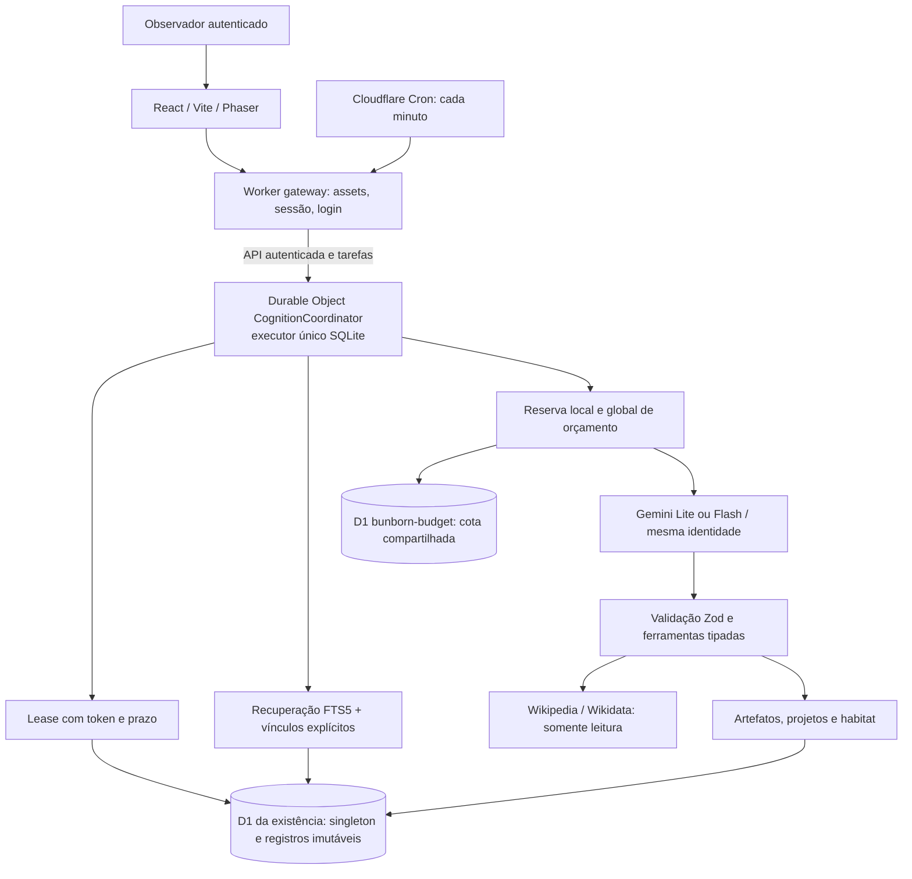

# Arquitetura técnica

Estado de 24/11/2026 (UTC). Implantado em homologação e produção na Cloudflare (Workers Free). Produção **sem criatura** e com nascimento bloqueado.

## Componentes

- **Worker (gateway fino)**: serve assets estáticos, responde `/api/session`, `/api/login` e `/api/logout`, verifica a sessão das outras rotas e as encaminha ao Durable Object. Sem sessão, só passam as rotas do **observatório público** (quando `PUBLIC_OBSERVATION=true`, hoje só em produção): `GET /api/state`, `/api/records`, `/api/monitor` (cache de 30 s por isolate, com chave formada só pelos parâmetros conhecidos) e `POST /api/message` (≤ 500 caracteres; 3/h por IP com hash e 30/h globais; autor `visitante`). O resto do tráfego anônimo recebe 401 sem consumir o DO. O Cron só encaminha a tarefa `scheduled`. Motivo: o Worker Free tem 10 ms de CPU por invocação; antes da mudança, a versão de produção tinha P99 de 13,7 ms no Cron e as rotas HTTP chegavam a P99 de 12,5–84,7 ms. Depois: P99 de 0,5–1,3 ms no Cron e de 4,7–7,1 ms no HTTP (medição em `TESTS.md`).
- **Durable Object `CognitionCoordinator`** (SQLite, disponível no Free): é um executor, não um subagente nem outra personalidade. Tarefas cognitivas e administrativas (ciclo, experimento, diagnóstico, ensaio de ferramentas, nascimento) entram numa fila serial. Leituras do observador não esperam atrás de uma chamada lenta ao modelo; toda mutação de estado continua cercada pela lease do D1. Identidade e história ficam **só no D1**: o armazenamento do DO não é usado.
- **D1 da existência**: `world` (estado singleton, revisão otimista), `records` (append-only), `memory_search` (FTS5), `record_links`, `retrievals`, `calls`/`budgets` locais, `inbox`, métricas, experimento e tabelas de backup/restauração.
- **D1 `bunborn-budget`**: reservas globais por modelo e dia do Pacífico, compartilhadas pelos dois ambientes, porque a chave Gemini é a mesma.

| Ambiente | Banco(s) | Finalidade |
|---|---|---|
| production (https://bunborn.devbarros.com) | `bunborn-production` + budget | Existência permanente futura. Vazia; `BIRTH_ENABLED=false`. |
| homologation | `bunborn-homologation` + budget | Criatura descartável, experimento de 24h. |
| homologation | `bunborn-tool-tests` (TOOL_DB) | Cenários **induzidos** de ferramentas, separados da criatura autônoma. |
| homologation | `bunborn-recovery` (RESTORE_DB) | Alvo isolado de restauração real. Hoje contém o arquivo da primeira criatura descartável. |

## Persistência

`records` é append-only por contrato. Cada versão de entidade é uma nova linha com o mesmo `entity_id`, e `seq` dá paginação estável. Commits são um único `batch` transacional do D1: `commit_guard` confere token de lease vigente e revisão esperada; se falhar, o batch inteiro é abortado. Uma execução atrasada não persiste nada depois de perder a lease. A chave primária de `world` impede um segundo nascimento.

Referências a entidades aceitam `entityId` (`artefato:poema`), o id curto (`poema`) ou o UUID concreto de qualquer versão daquele tipo, e sempre resolvem para a mesma entidade, sem duplicá-la. Isso corrigiu uma falha real observada nos ensaios induzidos: o modelo citava UUIDs válidos e o motor os rejeitava.

## Fluxo autônomo

1. Cron → gateway → DO (`scheduled`). Durante backup ou restauração, o ciclo não roda; o heartbeat é registrado mesmo assim.
2. Na homologação: sem experimento ativo, nada acontece. Prazo vencido ou teto de chamadas atingido → pausa e registro automáticos (`prazo_encerrado`/`orcamento_encerrado`).
3. Adquire a lease, reconcilia relógio, necessidades e fila de atividades (as atividades concluídas viram registros `atividade_concluida`, inclusive quando uma ação administrativa reconcilia o tempo).
4. Se ainda não é hora de decidir, grava só a atualização determinística.
5. Monta o contexto limitado (memórias recuperadas, interesses, projetos, conceitos, obras, erros e resultados recentes, mensagens), reserva cota local e depois global e chama um único modelo. O JSON é validado.
6. Executa no máximo 3 ações, cada uma num rascunho; uma ação rejeitada não altera o estado parcialmente. Rejeições guardam código **e detalhe factual** (referências ausentes, atividade em curso, estação necessária, minutos restantes), lido pela criatura no ciclo seguinte.
7. Commit atômico de estado, registros, vínculos e consumo de mensagens. O intervalo até a próxima decisão é escolhido pela criatura (máx. 60 min), com piso imposto pelo servidor: 5 min em produção, 15 min na homologação (para caber na cota da homologação).

Falha externa (por exemplo, HTTP 503 do Gemini) preserva a identidade, registra o código e agenda backoff exponencial (5 min a 6 h). Reservas não são devolvidas.

## Backup v2 segmentado

- `begin` exige pausa e lease, captura `MAX(rowid)` e `COUNT(*)` de cada tabela da existência e grava `backup-freeze` (expira em 1 h). Escritas pela API são recusadas enquanto durar; o ciclo não roda.
- `page` devolve até 80 linhas / 65 KB e grava o cabeçalho em `backup_segments` (uma linha por tabela+cursor, `ON CONFLICT DO NOTHING`). Requisições concorrentes ou repetidas não sobrescrevem umas às outras e precisam concordar no digest.
- `seal` percorre a cadeia contígua de segmentos a partir do cursor 0, ignora páginas fora da cadeia, exige a contagem exata congelada e assina `{manifest, segments}` com HMAC-SHA-256 sobre JSON canônico (chaves ordenadas por ponto de código, nunca por locale).
- Tabelas exportadas: `records`, `budgets`, `calls`, `inbox`, `retrievals`, `record_links`, `cycle_metrics`, `experiment`, `checkpoints`, `operations`. `heartbeats`, `rate_limits`, leases e controle de backup são operacionais, por implantação, e não entram.
- `restore/begin` valida assinatura e digest com schema estrito (campos extras não assinados são recusados). Em produção, aceita apenas origem `production`. Retoma uma sessão existente com o mesmo digest **antes** de exigir banco vazio, o que permite retomar uma importação parcial. Sessão nova exige alvo sem `world`, sem registros e sem outra restauração em andamento.
- `restore/page` confere o digest de cada segmento. `restore/apply` importa 3 segmentos por chamada com `INSERT … WHERE applied=0` na mesma transação que marca o segmento: chamadas concorrentes ou repetidas nunca duplicam. `world` é inserido por último, junto com a liberação da trava. Enquanto `restore-lock` existir, `/api/state` responde `restoring:true` sem dados e as demais leituras retornam 409: a história parcial não é exposta.
- O estado restaurado é gravado com o JSON exato do manifesto assinado (mesma ordem de chaves).
- A assinatura depende do `SESSION_SECRET` do ambiente. Backups de um ambiente não são aceitos em outro, e **trocar o `SESSION_SECRET` invalida backups v2 antigos**: guarde também a exportação SQL nativa do D1.

## Segurança

Login com comparação de hashes e rate limit (5 por IP e 30 globais a cada 15 min). Sessão HMAC de 24 h, cookie `HttpOnly; Secure; SameSite=Strict`. Todo POST exige `Origin` igual ao do próprio site. CSP `script-src 'self'`, `frame-ancestors 'none'`, `nosniff`. O React renderiza conteúdo como texto. Pesquisa só monta URLs de origens fixas e rejeita redirecionamentos. O modelo não altera código, cotas, permissões, configuração temporal nem relógio. Em produção, experimentos, relógio controlado, diagnóstico Gemini, ensaios de ferramentas, alvo de recuperação e restauração v1 são recusados no servidor. Mensagens de visitantes são dados não confiáveis como as demais e ficam registradas com `role/origin = visitante`, distintas das do responsável. Verificação remota: 40/40 (`artifacts/remote-security.json`).

## Evolução

Migrações apenas aditivas (0001–0008). `0007_backup_segments` e `0008_message_author` foram aplicadas aos quatro bancos de existência; `bunborn-budget` está na 0003 (só usa `budgets`/`calls`). `tests/database.ts` enumera as migrações explicitamente.
