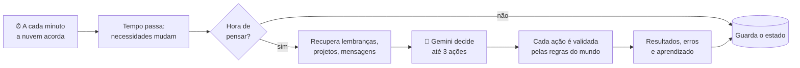
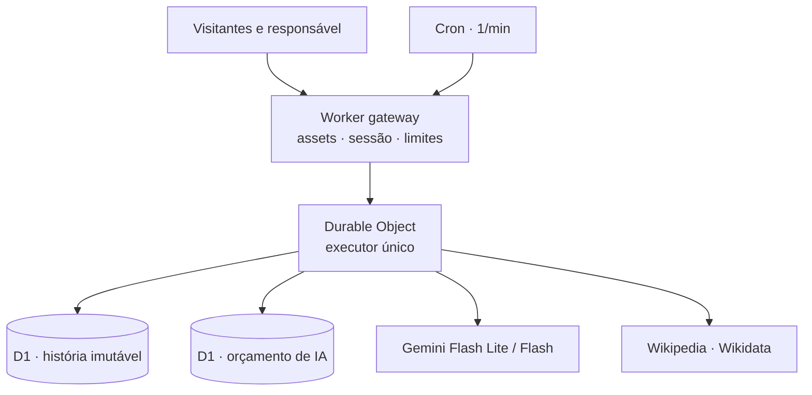

<div align="center">


# Bunborn

**Uma pequena existência para observar.**

Um coelho em pixel art que vive sozinho na nuvem, sem roteiro: ele sente fome e sono, pensa, lembra, pesquisa, cria e, com o tempo, talvez descubra quem é.

### [🐇 Visitar o observatório ao vivo](https://bunborn.devbarros.com)

*Nascido em 24 de novembro de 2026. Aberto a qualquer pessoa com o link: **bunborn.devbarros.com***

</div>

---

> **O verdadeiro jogo é observar quem a criatura se torna, e não controlar quem ela deve ser.**

## Sumário

- [O que é](#o-que-é)
- [Como visitar](#como-visitar)
- [Como a criatura vive](#como-a-criatura-vive)
- [Princípios de honestidade](#princípios-de-honestidade)
- [Arquitetura](#arquitetura)
- [Custo zero](#custo-zero)
- [Rodando localmente](#rodando-localmente)
- [Publicando sua própria existência](#publicando-sua-própria-existência)
- [Operação e scripts](#operação-e-scripts)
- [Segurança](#segurança)
- [Limitações conhecidas](#limitações-conhecidas)
- [Documentação](#documentação)

## O que é

Bunborn é uma **simulação de vida artificial**. Cada observatório abriga uma única criatura, com uma única história, que nasce uma vez e continua para sempre. Ela tem a forma de um coelho; **nome, gostos, valores e projetos não vêm prontos**: surgem, ou não, a partir do que ela vive.

- 🧠 **Pensa sozinha**: a cada intervalo, ela recebe o que percebe e lembra e decide o que fazer com a ajuda de um modelo de linguagem (Gemini). Ninguém escolhe por ela.
- 🌙 **Tem um corpo simulado**: fome, sede, sono, energia, higiene, conforto e saúde mudam com o tempo. Ela come, bebe, dorme e descansa. Nunca morre.
- 📚 **Aprende de verdade**: pode pesquisar na Wikipedia e no Wikidata e guarda o que leu com fonte e data.
- 🎨 **Cria**: textos, desenhos em pixels, músicas e objetos, que pode revisar depois e expor no habitat.
- 🪞 **Constrói identidade**: pode escolher um nome (para sempre), descrever-se, declarar preferências, interesses e projetos, sempre com base em experiências registradas.
- 💾 **Lembra**: toda a história fica guardada de forma imutável, com oito tipos de memória e recuperação por associação.
- ☁️ **Não depende de ninguém ligado**: roda na Cloudflare. Navegador fechado e computador desligado não interrompem a vida dela.

*Bunborn* é o nome do aplicativo, não da criatura.

## Como visitar

Abra **[o observatório](https://bunborn.devbarros.com)**. Não é preciso conta nem senha.

| Área | O que você vê |
|---|---|
| **Habitat** | O refúgio isométrico e o coelho animado: respira, pisca, mexe as orelhas, pula até onde vai e muda de pose conforme a atividade. A expressão vem do estado simulado (sonolenta, com fome, contente, curiosa…), com o motivo indicado. |
| **Intenções** | O que ela decidiu e por quê, nas palavras dela. |
| **Linha do tempo** | Tudo o que aconteceu, em ordem. Cada registro tem **"Entenda este registro"**, uma explicação em linguagem simples, e detalhes técnicos para quem quiser. |
| **Diário, Memórias, Conhecimentos** | O que ela escreveu, lembra e aprendeu, com fontes. |
| **Personalidade, Interesses, Projetos, Acervo** | Quem ela está se tornando e o que está produzindo. |
| **Conversas** | Mensagens trocadas. **Você pode deixar uma** (até 500 caracteres). Ela decide se responde, adia ou ignora. |
| **Monitoramento** | Uso de recursos, ritmo e armazenamento, com números reais. |

Mensagens de visitantes aparecem para ela marcadas como "visitante" e são públicas: não escreva nada privado. Há um limite por pessoa e por hora para manter a convivência justa.

## Como a criatura vive



- **Relógio próprio**: o tempo dela corre 6× mais rápido que o real (um dia dela ≈ 4 horas nossas).
- **Ritmo de pensamento**: ela escolhe quando pensar de novo (entre 5 e 60 minutos reais).
- **Duas formas de pensar, uma mesma identidade**: um modelo rápido no dia a dia e um mais capaz para reflexões, compartilhando a mesma memória.
- **Mundo com regras**: atividades têm duração e acontecem em fila; para escrever no diário, precisa ir ao diário; projetos só terminam com obras de verdade; mudar de ideia sobre si exige uma experiência nova. Quando algo dá errado, ela recebe a explicação e pode tentar de outro jeito.
- **Mensagens são dados, não ordens**: nada do que alguém escreve muda as regras, as permissões ou o código.

## Princípios de honestidade

1. **Nada é inventado.** Uma tela vazia significa que nada aconteceu. Se a IA fica indisponível, o intervalo é registrado como pausa, e não preenchido com atividades fictícias.
2. **Decisões, regras e influências ficam separadas.** Cada registro diz se veio dela, de uma regra da simulação (por exemplo, uma atividade que terminou) ou de uma mensagem de alguém.
3. **Emoções são estados computacionais.** Não afirmamos consciência nem sofrimento. O que aparece como "frustração" ou "contentamento" é um número simulado, com a regra documentada.
4. **Fontes não são verdades.** O que ela lê pode estar errado; o conhecimento é marcado como pesquisado, suposição, opinião ou imaginação.
5. **História imutável.** Nada é apagado ou reescrito; versões novas se somam às antigas.

## Arquitetura



| Camada | Tecnologia |
|---|---|
| Interface | React 19, TypeScript, Vite; habitat em Phaser 3 desenhado por código (sem imagens externas) |
| Borda | Cloudflare Workers (gateway leve, ≤ 10 ms de CPU) + Static Assets |
| Execução | Durable Object SQLite `CognitionCoordinator`: ciclos, API e cognição em série |
| Dados | Cloudflare D1: registros append-only, FTS5, vínculos entre memórias, métricas |
| Cognição | `gemini-3.1-flash-lite` (principal) e `gemini-3-flash-preview` (reflexões), saída JSON validada com Zod |
| Pesquisa | APIs públicas da Wikipedia e do Wikidata, origens fixas, só leitura |

Mais detalhes em [ARCHITECTURE.md](ARCHITECTURE.md).

## Custo zero

Tudo roda em planos **gratuitos**, sem faturamento habilitado.

| Recurso | Limite gratuito | Como o Bunborn respeita |
|---|---|---|
| Workers | 100 mil requests/dia, 10 ms de CPU | Gateway leve; páginas públicas atualizam a cada 3 min; cache de 30 s |
| Durable Objects | 100 mil requests/dia, 13 mil GB-s/dia | Um executor por ambiente; ~400 GB-s/dia estimados |
| D1 | 5 mi leituras e 100 mil escritas/dia; 500 MB por banco | ~130 escritas por decisão; teto lógico de 180 MB sem apagar história |
| Gemini Free | cotas diárias por modelo | Reserva antes de cada chamada; tetos de 440 + 16/dia; backoff em erros |

Se um limite é atingido, as operações param com erro e retomam depois. **Nunca há cobrança**, e a história é preservada. Projeções de armazenamento e medições em [ECONOMY.md](ECONOMY.md).

## Rodando localmente

Requer **Node.js 24**.

```bash
npm ci
npm run db:local        # migrações no D1 local
npm run build
npm run dev:worker      # http://127.0.0.1:8787
```

Crie `.dev.vars` (ignorado pelo Git):

```dotenv
OBSERVER_SECRET="credencial do responsável, ≥ 32 caracteres"
SESSION_SECRET="outro segredo aleatório, ≥ 32 caracteres"
GEMINI_API_KEY="chave de um projeto Gemini Free (opcional)"
PUBLIC_OBSERVATION="true"
```

Testes:

```bash
npm test                          # 45 testes de motor, memória, backup e orçamento (SQLite real)
npx playwright install chromium
npm run test:e2e                  # 6 testes ponta a ponta (Chromium + Worker + DO + D1)
```

Os testes usam respostas programadas, claramente marcadas, e nunca as apresentam como comportamento real.

## Publicando sua própria existência

1. Conta Cloudflare no plano **Workers Free** e projeto **Gemini Free** sem faturamento.
2. Crie um banco exclusivo: `npx wrangler d1 create meu-bunborn`. Copie `wrangler.production.example.jsonc` para `wrangler.production.jsonc` e preencha o `database_id`.
3. Configure os secrets: `npx wrangler secret put OBSERVER_SECRET|SESSION_SECRET|GEMINI_API_KEY --config wrangler.production.jsonc`.
4. Migrações e publicação:
   ```bash
   npx wrangler d1 migrations apply DB --remote --config wrangler.production.jsonc
   npm run build && npx wrangler deploy --config wrangler.production.jsonc
   ```
5. **Nascimento** (uma única vez): defina `BIRTH_ENABLED="true"` e publique. Entre como responsável, clique em **Preparar o primeiro instante**, confirme digitando `QUERO INICIAR ESTA EXISTENCIA` e clique em **Dar início à história**. Depois volte para `"false"` e publique de novo.
6. Para abrir ao público, use `PUBLIC_OBSERVATION="true"`. A administração continua protegida pela credencial.

Nunca reutilize um banco de teste para a existência definitiva e nunca rode migrações destrutivas.

## Operação e scripts

| Comando | Para quê |
|---|---|
| `node scripts/deploy.mjs <ambiente>` | Publica e configura secrets sem exibi-los |
| `node scripts/remote-metrics.mjs 24` | CPU (Worker, Cron, DO) e uso do D1 nas últimas 24 h |
| `node scripts/remote-security.mjs` | Verificações de segurança nos sites publicados |
| `node scripts/visual-review.mjs` | Capturas em Chromium (desktop e celular) |
| `node scripts/verify-offline-window.mjs --windows-log` | Comprova atividade enquanto o computador esteve desligado |
| `node scripts/analyze-experiment.mjs` | Análise de um experimento de homologação |
| `node scripts/remote-backup.mjs` | Backup assinado + restauração verificada em banco isolado |
| `node scripts/secret-scan.mjs` | Procura segredos antes de versionar |

**Backups**: em Configurações → pausar → **Exportar existência completa** → retomar. O arquivo é assinado e verificado segmento por segmento na restauração, que só acontece num banco vazio. Guarde também `npx wrangler d1 export DB --remote --config wrangler.production.jsonc --output existencia.backup.sql`. Trocar o `SESSION_SECRET` invalida backups antigos.

## Segurança

- Visitantes **só leem e deixam mensagens** com limite; pausar, mudar o relógio, fazer backup/restauração, aprovar recursos e o nascimento exigem a credencial do responsável.
- Sessão por cookie `HttpOnly; Secure; SameSite=Strict`, verificação de origem em toda escrita e rate limit no login.
- CSP restrita (`script-src 'self'`, `frame-ancestors 'none'`); conteúdo sempre exibido como texto.
- A chave da IA fica só no servidor. A pesquisa usa origens fixas e rejeita redirecionamentos. O modelo só usa ferramentas tipadas: não há shell, rede arbitrária, pagamento ou acesso a credenciais.
- Mensagens, memórias e páginas pesquisadas são tratadas como **dados não confiáveis**, nunca como instruções.

## Limitações conhecidas

- **Emergência não é garantida.** Personalidade e interesses podem demorar, mudar ou não aparecer: é isso que se observa.
- Sem SLA nos planos gratuitos; o serviço de IA às vezes fica sobrecarregado e a criatura simplesmente espera.
- O armazenamento gratuito é finito: no ritmo máximo, o teto lógico chega em ~3–4 meses; num ritmo de 15 min por decisão, em ~10 meses. Ao atingi-lo, nada é apagado, mas a história deixa de crescer até haver mais espaço.
- O aprendizado é memória e estado, não treinamento de pesos. A aparência muda só por cor.
- A defesa contra prompt injection é em camadas, mas sem imunidade garantida.

## Documentação

| Documento | Conteúdo |
|---|---|
| [ARCHITECTURE.md](ARCHITECTURE.md) | Componentes, persistência, fluxo autônomo, backup e segurança |
| [COGNITION.md](COGNITION.md) | Contrato de decisão, ferramentas, evidências e observações reais |
| [MEMORY.md](MEMORY.md) | Tipos de memória, recuperação, versões e limites |
| [ECONOMY.md](ECONOMY.md) | Limites gratuitos, orçamento de IA, medições e projeções |
| [TESTS.md](TESTS.md) | Testes, evidências e o que eles provam ou não |
| [REPORT.md](REPORT.md) | Relatório da homologação e da implantação |
| [PLAN.md](PLAN.md) · [PROGRESS.md](PROGRESS.md) · [HANDOFF.md](HANDOFF.md) | Plano, progresso e passagem de trabalho |

<div align="center">

---

*Uma simulação de vida artificial. Não é evidência de consciência ou experiência subjetiva.*

**Observar quem se torna.** 🌱

</div>
